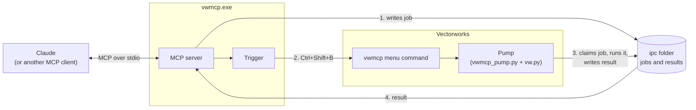
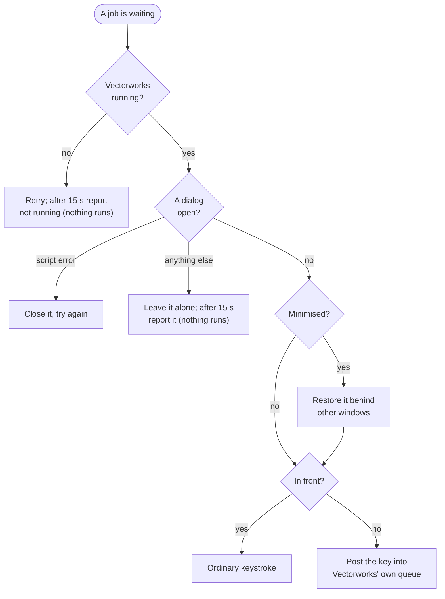
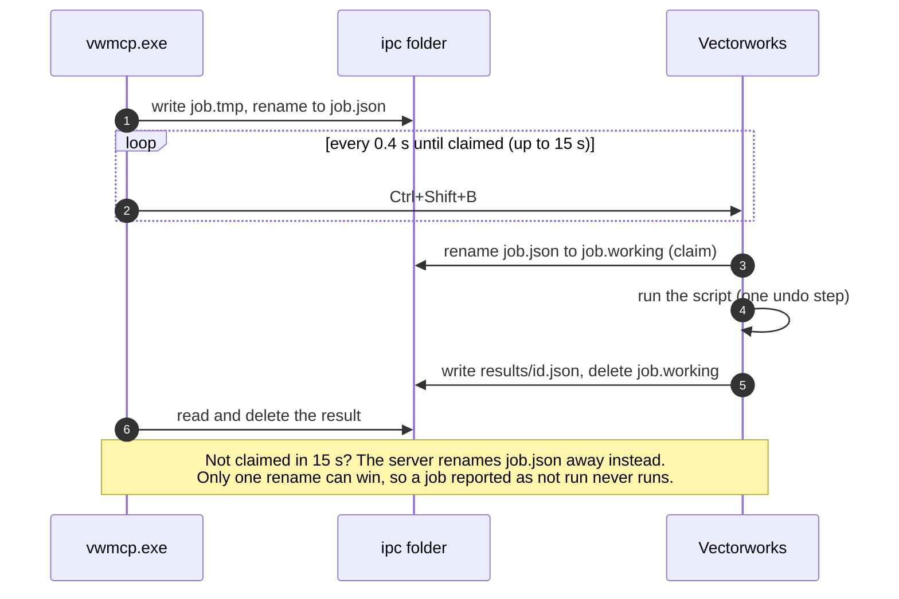

# How vwmcp talks to Vectorworks

vwmcp is two halves that never share a process: a program that your MCP client runs (`vwmcp.exe`), and a few Python files that Vectorworks runs. They talk through files in a folder, and a keyboard shortcut.

## Why a menu command?

Vectorworks runs Python in several places: web palettes, idle notifications, timers, menu commands. Only a menu command run the normal way (picked from a menu or by its shortcut) gives a script a proper document context, with undo and safe access to the drawing. vwx-mcp mapped this the hard way: changing the document from the other contexts crashed or hung Vectorworks in eight separate tests.

So everything that touches the drawing has to arrive as a menu command. vwmcp's command, `vwmcp`, is one line long. It loads `entry.py` from vwmcp's folder, which runs whatever jobs are waiting and returns. With no jobs waiting it does nothing, so running it by hand is harmless.

## Why a keyboard shortcut?

Something outside Vectorworks has to make it run that command. A shortcut is the most dependable way in: Vectorworks honours it wherever the command sits in its menus. How vwmcp delivers it depends on what state Vectorworks is in:

- **Vectorworks is in front:** an ordinary keystroke, as if you'd pressed it.
- **Vectorworks is behind other windows:** vwmcp briefly shares Vectorworks' keyboard state, so it reads Ctrl and Shift as held, and posts the key into Vectorworks' own message queue. Vectorworks treats it as its shortcut. No other application sees anything, so you can keep typing elsewhere.
- **Vectorworks is minimised:** it doesn't react to shortcuts, so vwmcp restores it behind your other windows without bringing it forward, and minimises it again a few seconds after the last job.

vwx-mcp did the same from a C++ palette inside Vectorworks, which meant building against the Vectorworks SDK and installing into Program Files. Doing it from outside means vwmcp needs no compiled plug-in at all.

## Why files?

The menu command can't hold a network connection open: it has to start, run what's waiting and return, or it would freeze Vectorworks. Files are the simplest queue that survives that.

Each step uses atomic renames, so nothing is half-written or run twice:

1. The server writes `job.tmp`, then renames it to `job.json`.
2. Vectorworks claims a job by renaming it to `job.working`. If it isn't claimed within 15 seconds, the server renames it away instead. Only one rename can win.
3. Vectorworks writes the result, and the server reads it and deletes it.

## Why are tools Python sent with each job?

The Vectorworks side is a generic runner: it executes whatever code the job carries, with `vs`, `params` and the `vw` helpers to hand. Every tool, including `document_overview` and `library_import`, is a few lines of Python inside `vwmcp.exe`.

So changing or adding a tool never means touching Vectorworks. The server rewrites its Python files when it starts, and Vectorworks reloads them when they change.

## Error dialogs

Some Vectorworks errors (a wrong argument count, a bad callback) don't raise a Python exception. They open a modal "Script Errors" dialog, sometimes after the script has finished. Left open, that dialog blocks every later job.

vwmcp watches for Vectorworks dialogs whose title or text marks them as script errors, and closes them while a job runs and for a few seconds afterwards. Other dialogs are never touched, in case you're working in them; vwmcp reports them and waits instead.

## Starting and stopping

Nothing needs starting by hand:

- **Claude Desktop** starts `vwmcp.exe serve` when it opens and stops it when it closes.
- **Vectorworks** loads the `vwmcp` command with its other plug-ins. It only does anything when a job is waiting.

They can start in either order. If Vectorworks isn't open, tools say so; open it, and the next call works.
